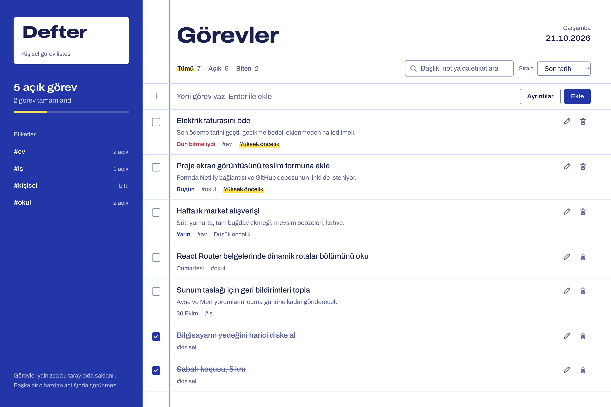
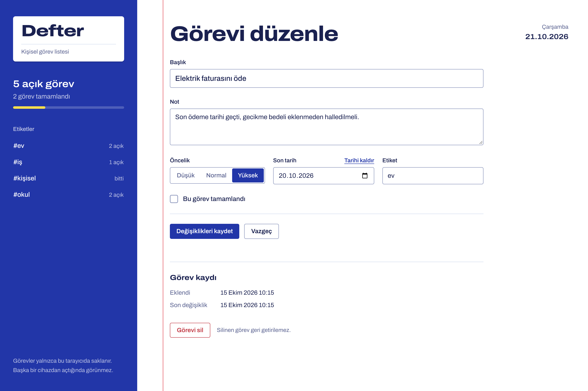
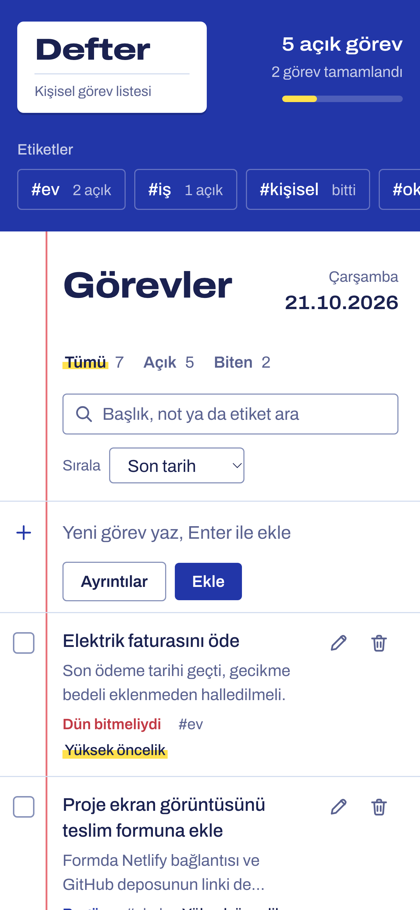

# Defter

Defter, görevlerini ekleyip düzenleyebileceğin ve tamamladıklarının üstünü çizebileceğin kişisel bir görev listesi. Arayüz bir okul defterini örnek alıyor: kapakta ilerleme ve etiketler, çizgili sayfada görevler, kırmızı kenar boşluğunda da onay kutuları yer alıyor.

Bu proje *Web Geliştirme; JavaScript Proje Yönergesi* kapsamında React ile hazırlandı. Veriler tarayıcının `localStorage` alanında saklanıyor, sunucu ya da hesap gerekmiyor.

**Canlı sürüm:** _Netlify bağlantısını buraya ekle_

## Ekran görüntüleri







## Özellikler

| İşlem | Nerede |
| --- | --- |
| **Ekleme** | Listenin ilk satırına başlığı yazıp Enter'a bas. *Ayrıntılar* ile not, öncelik, son tarih ve etiket eklenebilir. |
| **Listeleme** | Görevler son tarihe, önceliğe ya da eklenme sırasına göre listelenir. Durum sekmeleri, arama ve etiket filtresi bulunur. |
| **Güncelleme** | Onay kutusu görevi tamamlandı olarak işaretler. Başlığa ya da kalem simgesine tıklayınca `/gorev/:id` düzenleme sayfası açılır. |
| **Silme** | Çöp kutusu simgesi ya da düzenleme sayfasındaki *Görevi sil* düğmesi, onay penceresinden sonra görevi siler. Tamamlananlar toplu olarak da silinebilir. |

Diğer ayrıntılar:

- Filtreler adres çubuğunda tutulur (`/?durum=acik&etiket=okul`), bağlantı paylaşıldığında aynı görünüm açılır.
- Gecikmiş görevler kırmızı, bugün ve yarın bitmesi gerekenler mavi renkle belirtilir.
- İlk açılışta örnek görevler yüklenir. Silindiklerinde bir daha eklenmezler.
- Klavyeyle kullanılabilir, ekran okuyucular için etiketler ve canlı bölgeler tanımlıdır, `prefers-reduced-motion` ayarına uyulur.

## Kullanılan teknolojiler

- [React 19](https://react.dev) ve TypeScript
- [Vite](https://vite.dev) geliştirme sunucusu ve derleyici
- [React Router](https://reactrouter.com) sayfa yönlendirmesi
- [Tailwind CSS 4](https://tailwindcss.com) stiller
- [Archivo](https://fonts.google.com/specimen/Archivo) yazı tipi (`@fontsource-variable/archivo`)
- [Vitest](https://vitest.dev) birim testleri
- [Netlify](https://www.netlify.com) yayın

## Klasör yapısı

```
src/
├── components/   Arayüz bileşenleri (liste, form, araç çubuğu, onay penceresi…)
├── pages/        Sayfalar: TasksPage, EditTaskPage, NotFoundPage
├── interfaces/   TypeScript arayüzleri ve tipleri
├── context/      Görev durumunu paylaşan React Context
├── hooks/        useTasks, useTaskQuery, useStableTaskOrder…
├── services/     localStorage okuma ve yazma
├── utils/        Tarih, filtreleme ve form yardımcıları (testleriyle birlikte)
└── data/         İlk açılışta yüklenen örnek görevler
```

## Kurulum

Node.js 22 veya üstü gerekir.

```bash
npm install
npm run dev
```

Uygulama `http://localhost:5173` adresinde açılır.

| Komut | Açıklama |
| --- | --- |
| `npm run dev` | Geliştirme sunucusunu başlatır |
| `npm run build` | Tip kontrolü yapar ve `dist/` klasörüne derler |
| `npm run preview` | Derlenmiş sürümü yerelde sunar |
| `npm run test` | Birim testlerini çalıştırır |
| `npm run lint` | Kodu oxlint ile denetler |

## Netlify'a yayınlama

Proje kökündeki `netlify.toml` derleme komutunu, yayın klasörünü ve sayfa yönlendirmesini tanımlar. Bu yönlendirme sayesinde `/gorev/...` gibi adresler yenilendiğinde 404 hatası alınmaz.

1. Projeyi GitHub'a gönder.
2. Netlify'da **Add new site → Import an existing project** adımlarını izleyip GitHub deposunu seç.
3. Ayarlar `netlify.toml` dosyasından okunur (`npm run build`, `dist`). **Deploy** ile yayına al.
4. Oluşan `*.netlify.app` adresini bu dosyanın başına ve teslim formuna ekle.
